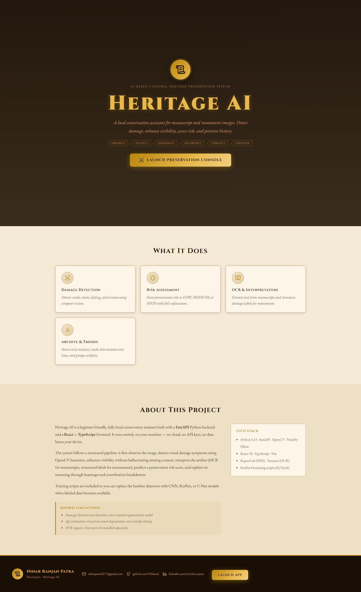
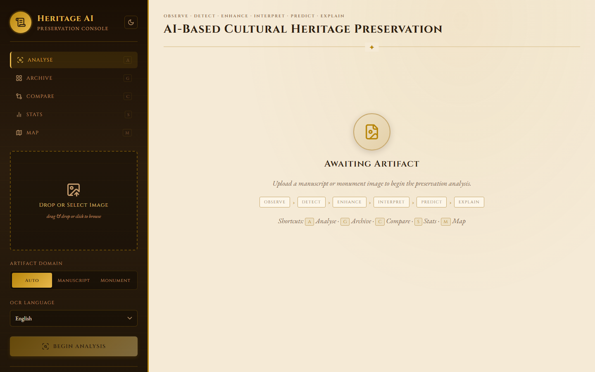
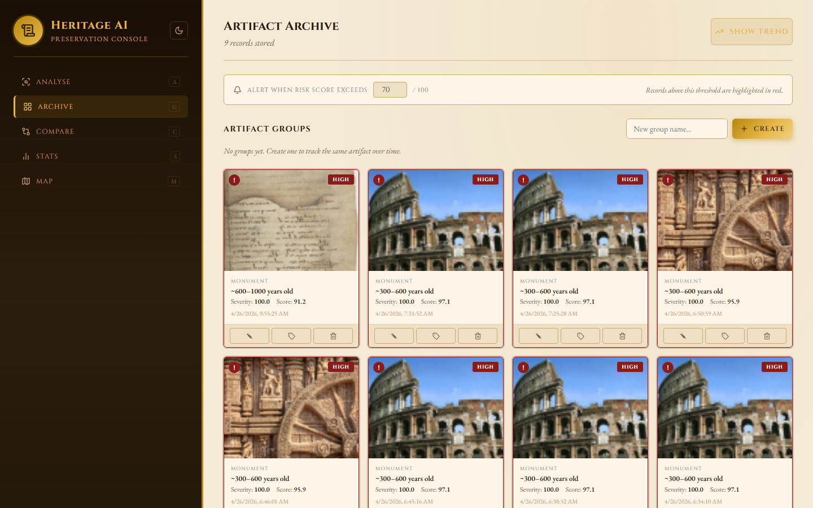
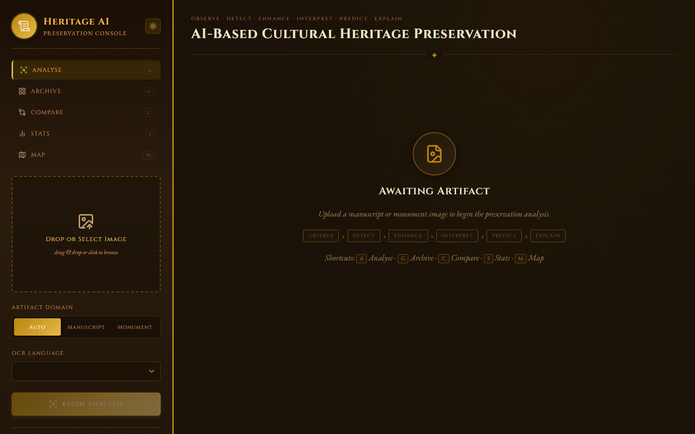
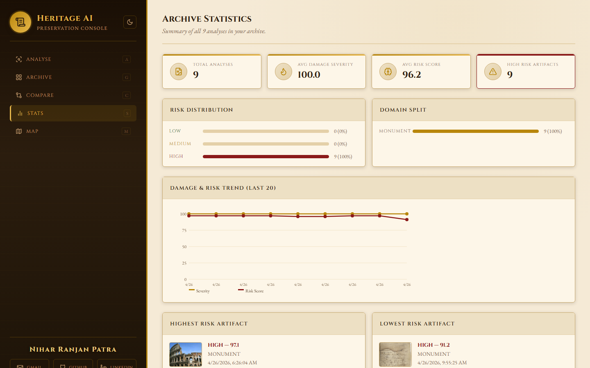
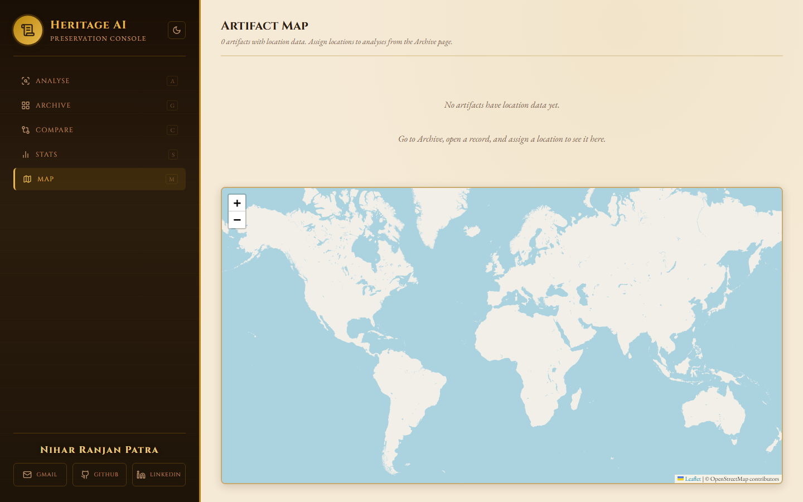

# Heritage AI - AI-Based Cultural Heritage Preservation System

<p align="center">
  
  
  
  
</p>

> Built by **Nihar Ranjan Patra**  
> [Email](mailto:niharpatra2277@gmail.com) | [GitHub](https://github.com/Niharxd) | [LinkedIn](https://www.linkedin.com/in/nihar-patra-98841336a/)

Heritage AI is a local, beginner-friendly conservation assistant for manuscript and monument images. It supports preliminary image analysis, damage indicators, OCR, risk scoring, conservation suggestions, and historical record management.

**No cloud or API keys required.** The core application runs locally on your machine. Map tiles and geocoding require an internet connection.

---

### Architecture overview

| Layer | Main responsibilities |
|---|---|
| Frontend | React and TypeScript views for the archive, statistics, map, comparison, image quality, batch results, and annotations |
| API client | Connects the frontend to backend endpoints |
| FastAPI backend | Handles requests, coordinates analysis, manages records, and generates reports |
| Image analysis | Preprocessing, enhancement, damage detection, OCR, explainability, age estimation, and risk scoring |
| Archive and reporting | Stores analysis history, notes, groups, and locations; generates PDF reports |
| External services | OpenStreetMap and Nominatim support map tiles and place geocoding |

## Architecture

The diagram below shows how the conservator interface connects to the API, archive and reporting, and image analysis pipeline.


---

### Analysis pipeline

```text
Observe -> Detect -> Enhance -> Interpret -> Predict -> Explain
```

The pipeline combines image-processing techniques and rule-based analysis to produce structured findings. Results are intended for preliminary review and conservation decision support, not professional structural diagnosis.

---

## Screenshots

| Landing Page | Analyse View |
|---|---|
|  |  |

| Archive | Dark Mode |
|---|---|
|  |  |

| Statistics | Map View |
|---|---|
|  |  |

---

## Features

### Analysis

- **Damage Detection:** Uses OpenCV heuristics to identify indicators such as cracks, stains, fading, and erosion.
- **Image Enhancement:** Denoising, CLAHE, and adaptive thresholding without intentionally generating missing content.
- **OCR:** Extracts manuscript text using Tesseract with support for 11 languages.
- **Structured Labels:** Counts and marks damage types for monument images.
- **Risk Scoring:** Produces LOW, MEDIUM, or HIGH risk classifications with score breakdowns and explanations.
- **Heatmap Explainability:** Visualizes regions associated with detected damage indicators.
- **Degradation-Based Age Estimate:** Estimates artifact age from visual degradation, with limitations clearly stated.
- **Restoration Suggestions:** Maps detected damage types to conservation techniques and urgency levels.

### Image Tools

- **Heatmap Slider:** Blends the heatmap over the original image in real time.
- **Detection Inspector:** Highlights a detection region when its table row is selected.
- **Image Lightbox:** Opens analysis images in fullscreen mode.
- **Annotation Tool:** Draws rectangles and adds notes to image regions.

### Batch Analysis and Export

- Upload and analyze up to 10 images in one batch.
- Review results in a summary table.
- Generate PDF conservation reports with images, tables, and recommendations.
- Export complete analysis data as JSON.
- Export detections as CSV.

### Archive

- Automatically saves analysis history with thumbnails, risk scores, and age estimates.
- Maintains notes and conservator journal entries.
- Groups records associated with the same artifact.
- Tracks deterioration trends over time.
- Supports configurable risk alert thresholds.
- Deletes individual analysis records.

### Map View

- Interactive world map using Leaflet and OpenStreetMap.
- Risk-colored pins for LOW, MEDIUM, and HIGH results.
- Place-name geocoding through Nominatim.
- Popups containing thumbnails, locations, risk levels, domains, dates, and analysis links.

### User Interface

- Landing page with project information and feature overview.
- Dark parchment theme with persistent preferences.
- Keyboard shortcuts for navigating views.
- Drag-and-drop image uploads.
- Image quality warnings for dark, overexposed, blurry, or undersized images.
- Progress indicators and toast notifications.
- Side-by-side comparison of previous analyses.
- Statistics for analysis totals, average severity, risk distribution, and domain split.

---

## OCR Language Support

| Language | Tesseract code |
|---|---|
| English | `eng` |
| Hindi | `hin` |
| Sanskrit | `san` |
| Tamil | `tam` |
| Telugu | `tel` |
| Arabic | `ara` |
| Persian | `fas` |
| Greek | `ell` |
| Latin | `lat` |
| Chinese Simplified | `chi_sim` |
| Japanese | `jpn` |

---

## Project Structure

```text
History/
├── backend/
│   ├── age_estimation.py
│   ├── damage_detection.py
│   ├── enhancement.py
│   ├── explainability.py
│   ├── history_store.py
│   ├── ocr_engine.py
│   ├── pdf_report.py
│   ├── pipeline.py
│   ├── preprocessing.py
│   ├── restoration_suggestions.py
│   └── risk_prediction.py
├── frontend/
│   ├── screenshots/
│   └── src/
│       ├── components/
│       │   ├── AnnotationTool.tsx
│       │   ├── BatchResults.tsx
│       │   ├── DarkMode.tsx
│       │   ├── DetectionInspector.tsx
│       │   ├── HeatmapSlider.tsx
│       │   ├── ImageLightbox.tsx
│       │   ├── ImageQuality.tsx
│       │   ├── LocationPicker.tsx
│       │   ├── ProgressSteps.tsx
│       │   ├── Toast.tsx
│       │   └── TrendChart.tsx
│       ├── pages/
│       │   ├── Compare.tsx
│       │   ├── Gallery.tsx
│       │   ├── LandingPage.tsx
│       │   ├── MapView.tsx
│       │   └── StatsPage.tsx
│       ├── App.tsx
│       ├── api.ts
│       ├── styles.css
│       └── types.ts
├── training/
│   ├── download_material_dataset.py
│   ├── generate_synthetic_data.py
│   ├── train_damage_classifier.py
│   ├── train_enhancement_autoencoder.py
│   └── train_material_classifier.py
├── utils/
│   ├── image_io.py
│   └── visualization.py
├── data/
│   ├── raw/
│   ├── processed/
│   └── synthetic/
├── models/
├── outputs/
├── docs/
│   └── architecture.png
├── app.py
├── generate_screenshots.py
├── requirements.txt
├── start_backend.bat
└── start_frontend.bat
```

---

## Setup

### 1. Install Python dependencies

Python 3.13 is used by the project documentation.

```bash
pip install -r requirements.txt
```

### 2. Install Tesseract OCR

Tesseract is optional but recommended for OCR functionality.

Download it from the [Tesseract for Windows installation page](https://github.com/UB-Mannheim/tesseract/wiki).

Make sure `tesseract.exe` is available on your PATH. Install the required language data packs for non-English OCR.

### 3. Install Node.js

Download Node.js from [nodejs.org](https://nodejs.org/) if it is not already installed.

### 4. Install frontend dependencies

```bash
cd frontend
npm install
```

---

## Run the Application

### Option A: Windows batch files

1. Double-click `start_backend.bat`.
2. Double-click `start_frontend.bat`.
3. Keep both terminal windows open.

### Option B: Run from terminals

Start the backend in the first terminal:

```bash
python -m uvicorn app:app --host 127.0.0.1 --port 8000
```

Start the frontend in a second terminal:

```bash
cd frontend
npm run dev
```

Open the frontend in your browser:

```text
http://127.0.0.1:5173
```

---

## Keyboard Shortcuts

| Key | Action |
|---|---|
| `A` | Analyse view |
| `G` | Archive |
| `C` | Compare |
| `S` | Statistics |
| `M` | Map view |
| `Enter` | Run analysis when a file is selected |
| `Escape` | Close lightbox or modal |

---

## Model Training

### Damage classifier

The project includes a ResNet18-based damage classification training script.

```bash
python training/train_damage_classifier.py --data data/classification --epochs 15
```

Expected data layout:

```text
data/classification/
├── crack/
├── stain/
├── fading/
├── erosion/
└── clean/
```

### Enhancement autoencoder

Generate synthetic training data and train the enhancement autoencoder:

```bash
python training/generate_synthetic_data.py --count 500
python training/train_enhancement_autoencoder.py --data data/synthetic --epochs 10
```

### Dataset sources

- [DIBCO / H-DIBCO](https://paperswithcode.com/dataset/dibco-and-h-dibco) - degraded manuscript documents.
- [Historical-crack18-19](https://pmc.ncbi.nlm.nih.gov/articles/PMC8818920/) - historical building cracks.
- [CODEBRIM](https://datasetninja.com/codebrim) - concrete defect classes.
- [Roboflow crack detection](https://universe.roboflow.com/shm-v25ds/crack-detection-7lgyo) - crack detection datasets.
- [StructDamage](https://arxiv.org/abs/2603.10484) - structural damage classification.

---

## Known Limitations

- Damage detection currently uses OpenCV heuristics rather than a trained segmentation model. Results vary with image quality.
- Age estimation is based on visual degradation and is not a scientific dating method.
- OCR accuracy depends on image quality and the installed Tesseract language packs.
- The map view requires an internet connection for OpenStreetMap tiles and Nominatim geocoding.
- Risk scores and restoration suggestions are preliminary decision-support outputs, not professional conservation certifications.

---

## Tech Stack

| Layer | Technology |
|---|---|
| Backend | Python 3.13, FastAPI, Uvicorn |
| Computer Vision | OpenCV, NumPy, Pillow |
| OCR | Tesseract, pytesseract |
| PDF Reports | ReportLab |
| Machine Learning | PyTorch, torchvision, ResNet18 |
| Frontend | React 18, TypeScript, Vite |
| Maps | Leaflet, OpenStreetMap |
| Geocoding | OpenStreetMap Nominatim |

---

## Future Improvements

- Replace heuristic masks with a trained U-Net or YOLO segmentation model.
- Evaluate EfficientNet or ConvNeXt for damage classification.
- Add Grad-CAM for trained CNN predictions.
- Store reports in SQLite or PostgreSQL instead of JSON files.
- Add user authentication for multi-user conservation teams.
- Deploy with Docker and Nginx for institutional use.

---

<p align="center">
  <strong>Heritage AI - Supporting cultural heritage preservation through local image analysis and explainable decision support.</strong>
</p>

<p align="center">
  <a href="https://github.com/Niharxd/HeritageAI">GitHub Repository</a> |
  <a href="mailto:niharpatra2277@gmail.com">Contact</a> |
  <a href="https://www.linkedin.com/in/nihar-patra-98841336a/">LinkedIn</a>
</p>
